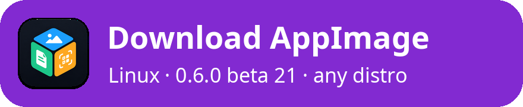
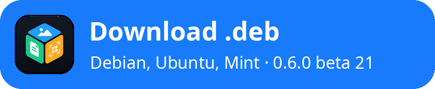
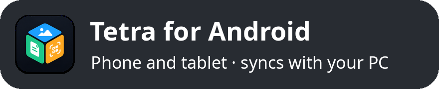
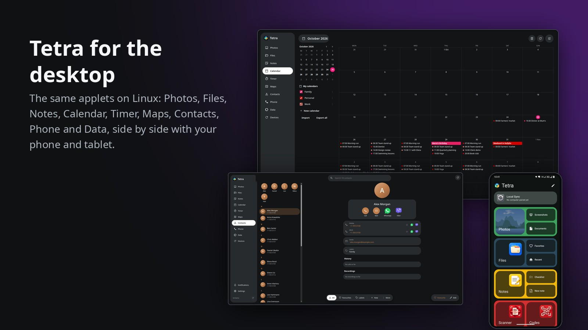
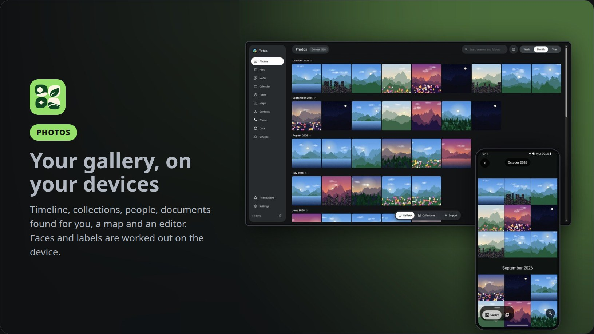
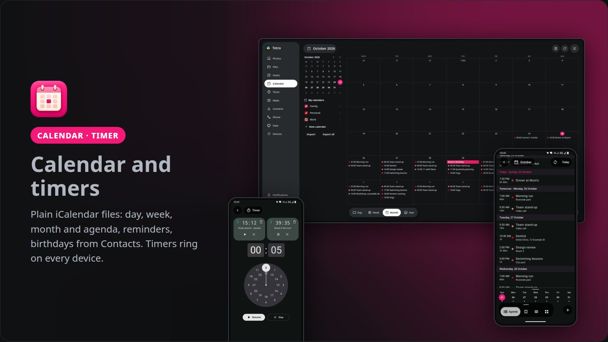
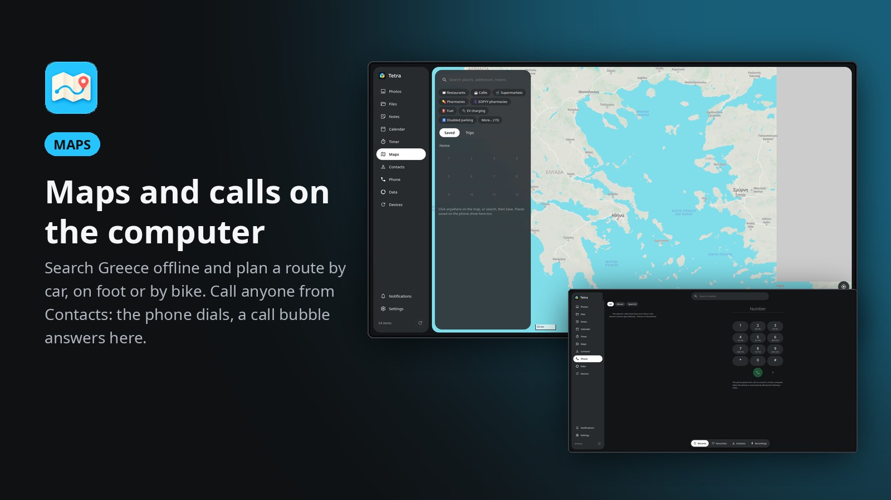
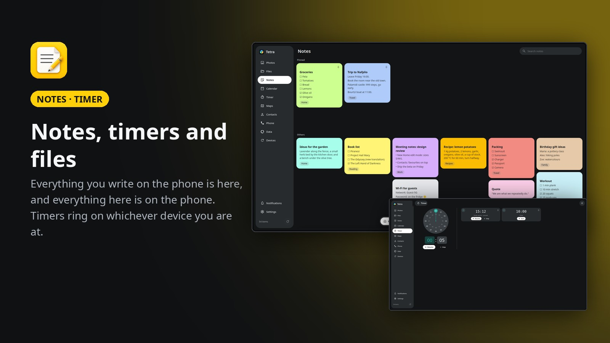
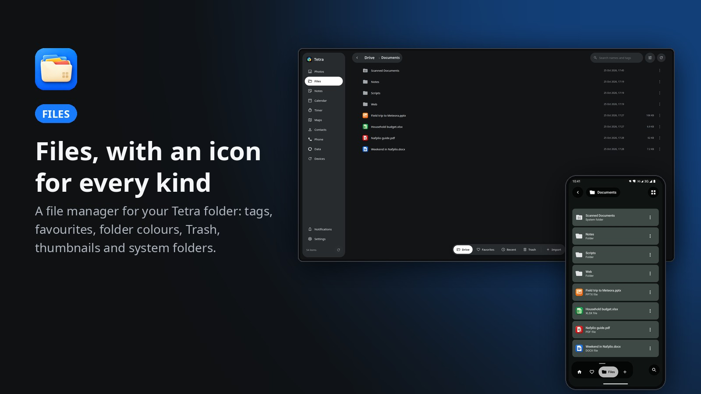

<h1 align="center">Tetra for the desktop</h1>

<p align="center"><b>The computer side of one private super app.</b><br>
Photos, files, notes, calendar, timers, maps, contacts, calls and data on Linux, in sync with your phone and tablet, with nothing uploaded anywhere.</p>

<p align="center">
  <a href="https://github.com/kalotrapezis/Drive/releases/download/desktop-v0.6.0-beta.21/Tetra-0.6.0-beta.21.AppImage"></a>
  <a href="https://github.com/kalotrapezis/Drive/releases/download/desktop-v0.6.0-beta.21/local-drive-desktop_0.6.0-beta.21_amd64.deb"></a>
</p>
<p align="center">
  <a href="https://github.com/kalotrapezis/Drive-Android"></a>
</p>



Tetra for the desktop is the computer half of [Tetra for Android](https://github.com/kalotrapezis/Drive-Android).
The same applets live on both: what you write, shoot, plan or save on the phone is here, and the other way round.
Phone, tablet and computer **sync over your own Wi-Fi**: no server, no account, no cloud. Faces, documents and search
labels are analysed on this computer.

**Current release: 0.6.0 Beta 21** (Linux, AppImage and `.deb`). A beta: in daily use by its author, but keep your
own backups.

<sub>Every screenshot here uses invented sample data: made-up people, generated pictures, sample documents.</sub>

## New in 0.6 beta

- **Contacts** with faces from Photos, favourites, labels and birthdays, the same vCard files as on the phone.
- **Phone**: call anyone from Contacts and the phone dials; a **call bubble** on the computer answers, holds, mutes
  and hangs up; the phone's call history, Favourites and Recordings here too.
- **Maps\*** of Greece offline: search, places, lists, trips, and routes by car, on foot and by bike.
- **Data**: the phone's and tablet's usage beside this computer's, the plan, Wi-Fi signal and drops.
- **Calendar and Timer**, file-type icons and thumbnails in Files, and **every page opens fast** (below).

## The applets








| | |
|---|---|
| **Photos** | Week, month and year timeline, collections, favourites, folder albums, People, Documents, a map, search, an editor and an encrypted **Hidden** vault. |
| **Files** | `~/Tetra/Files`, with tags, favourites, folder colours, an icon for every kind of file, a reversible Trash, and import in verified batches. |
| **Notes** | Notes and checklists with colours, labels, pins and a history of versions. |
| **Calendar** | iCalendar (`.ics`) files in `~/Tetra/Files/Calendar`: day, week, month and year, repeats, reminders, import and export. |
| **Timer** | Timers that ring on whichever device you are at. |
| **Maps\*** | OpenStreetMap of Greece on this computer: search, saved places, lists and trips, routes. |
| **Contacts** | vCard files with faces, favourites, labels and history. |
| **Phone** | Calls through your phone: the call bubble, Recents, Favourites, Recordings. |
| **Data** | Usage across the phone, the tablet and this computer, the plan, Wi-Fi signal and drops. |
| **Devices** | Pair a phone or tablet by QR code. Every photo and file is checked by SHA-256 on arrival. Rules per device and per kind: send, both ways, or Move. |
| **Storage drives** | A USB drive as a **backup** (a verified copy) or as **storage**: old photos move there and still show in the library. Tetra tells you before the disk fills up. |
| **Trash → purgatory → gone** | Deleted items wait 30 days in the Trash, then 30 more in a purgatory, before they are really gone. |

<sub>\* Maps covers Greece only for now; other countries will follow.</sub>

## Fast

Each page was measured on a copy of a real library (16 619 photos): how long until it stops changing, and the longest
moment the window could not answer. Files, Notes, Calendar, Timer, Maps, Contacts, Data, Devices and Settings were
already quick (2–160 ms). Two froze the window, and no longer do:

| Page | before | now | what changed |
|---|---|---|---|
| Photos (opened again) | 741 ms, the window busy 599 ms | 71 ms, never busy | a period's photos are made only within two screens of the view, so any size of library opens the same |
| Phone | 510–545 ms, busy 288–293 ms | 47–76 ms, never busy | sixty recent calls at first, more as the list's end nears |

On the phone, the same week, Contacts went from 3.3 s to 0.19 s and the Phone from 2.3–2.8 s to 0.25 s: see
[Tetra for Android](https://github.com/kalotrapezis/Drive-Android#fast).

## Sync


Pair once by QR code from **Devices**. Photos, files, notes, calendars, contacts, places, timers and calls travel over
your own network, each file checked by SHA-256. A trusted device is known by its public-key fingerprint, not its IP
address, so it is found again after a network change. Every rule and its reason is in [SYNC_PLAN.md](SYNC_PLAN.md).

## Install

<a href="https://github.com/kalotrapezis/Drive/releases/download/desktop-v0.6.0-beta.21/Tetra-0.6.0-beta.21.AppImage"></a>
<a href="https://github.com/kalotrapezis/Drive/releases/download/desktop-v0.6.0-beta.21/local-drive-desktop_0.6.0-beta.21_amd64.deb"></a>

On Debian, Ubuntu or Mint:

```bash
sudo apt install ./local-drive-desktop_0.6.0-beta.21_amd64.deb
```

Or make the AppImage executable and run it (`chmod +x Tetra-0.6.0-beta.21.AppImage`); it needs `libfuse2` on
Ubuntu 24.04 and newer. Tetra keeps running in the tray when its window is closed, so phones can sync at any time.

Then install [Tetra for Android](https://github.com/kalotrapezis/Drive-Android) on your phone or tablet and pair it
from **Devices**.

## Build

The app is in [desktop/](desktop/README.md) (Electron, React, TypeScript).

```bash
cd desktop
npm ci
npm test
npm run dist    # release/*.deb and *.AppImage
```

## Documentation

| Document | Purpose |
|---|---|
| [desktop/README.md](desktop/README.md) | The desktop app's code map, folders and development commands |
| [SYNC_PLAN.md](SYNC_PLAN.md) | Sync design and every rule's reason (the same file in both repos) |
| [HANDOFF.md](HANDOFF.md) | Where work stands, newest first |

## Licence

Tetra is free software under the [GNU GPL 3.0](LICENSE), and will stay free.

---

## History: the C++/Qt "Local Drive"

Until September 2026 this repository held a C++/Qt desktop app with a browser-page interface. It was replaced by
the Electron app in `desktop/` and removed on 26 September 2026. Its code, plans and safety specification are in the
history, at commit [`1b71025`](https://github.com/kalotrapezis/Drive/tree/1b710253ee846a965f3524138332fda6ae37897a).
