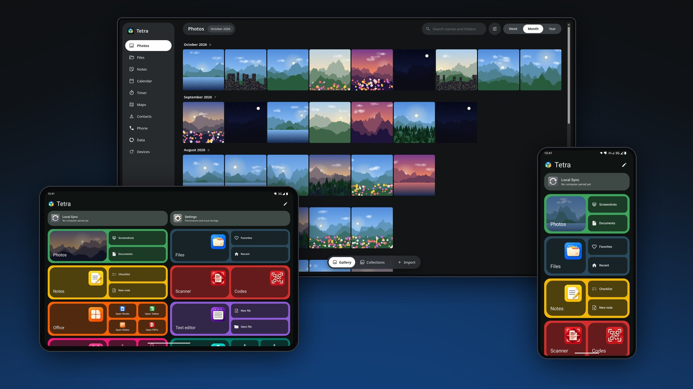
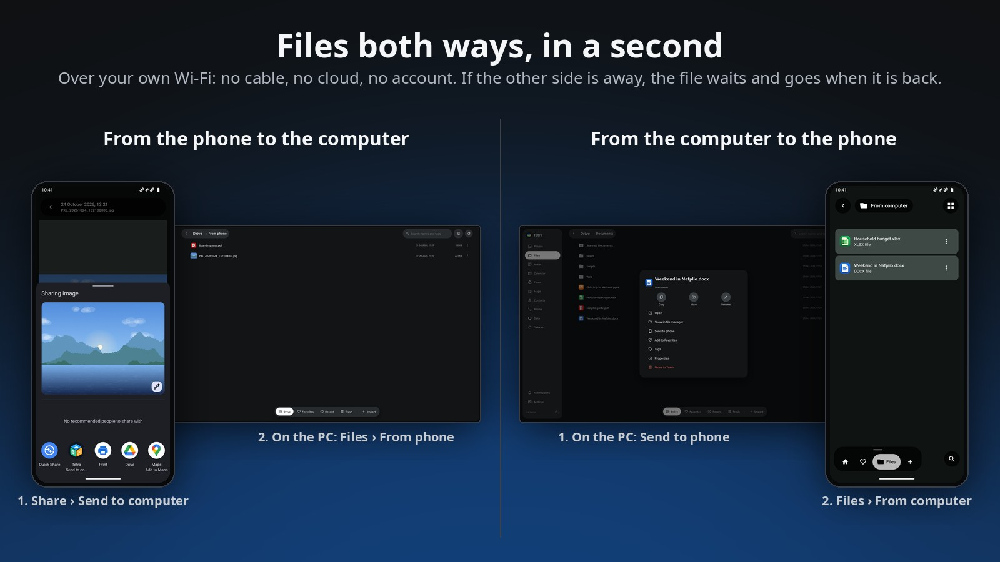
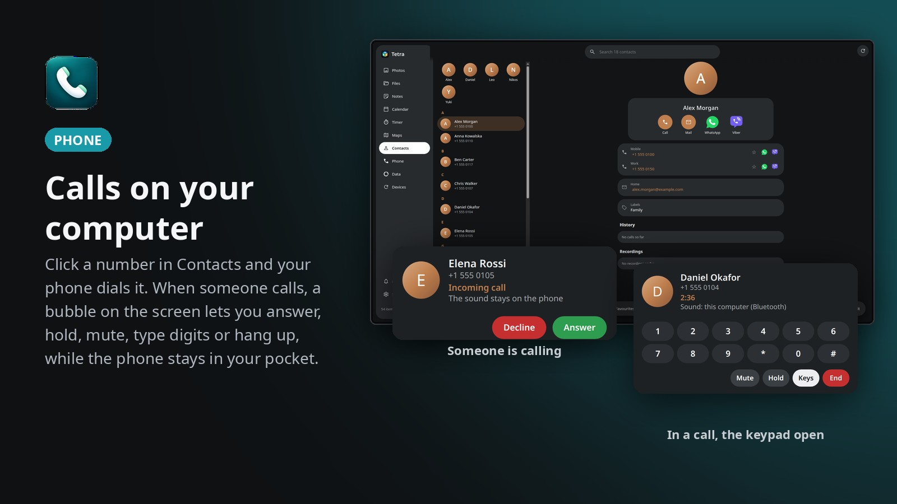

<h1 align="center">Tetra for the desktop</h1>

<p align="center"><b>The computer side of one private super app.</b><br>
Photos, files, notes, calendar, timers, maps, contacts, calls and data on Linux, in sync with your phone and tablet, with nothing uploaded anywhere.</p>

<p align="center">
  <a href="https://github.com/kalotrapezis/Drive/releases/download/desktop-v0.6.0-beta.21/Tetra-0.6.0-beta.21.AppImage"></a>
  <a href="https://github.com/kalotrapezis/Drive/releases/download/desktop-v0.6.0-beta.21/local-drive-desktop_0.6.0-beta.21_amd64.deb"></a>
</p>
<p align="center">
  <a href="https://github.com/kalotrapezis/Drive-Android"></a>
</p>



The computer half of [Tetra for Android](https://github.com/kalotrapezis/Drive-Android): Photos, Files, Notes,
Calendar, Timer, Maps\*, Contacts, Phone and Data on Linux, in sync with your phone and tablet over your own Wi-Fi.
Faces, documents and search labels are analysed on this computer.

**0.6.0 Beta 21** ([what's new](https://github.com/kalotrapezis/Drive/releases/tag/desktop-v0.6.0-beta.21)). A beta: keep
your own backups. Screenshots use invented sample data.

## What Tetra does for you

- **Files to and from your phone in a second.** *Send to phone* in Files or from the tray, and *Send to computer* in
  the phone's share menu. Over your own Wi-Fi: no cable, no cloud. They land in `From phone` and `From computer`.
- **Call from your computer.** Click a number in Contacts and your phone dials it; a call bubble answers, holds, mutes
  and hangs up here, and the phone's Recents and Recordings are here too.
- **Your data plan, watched.** The phone's and the tablet's usage beside this computer's; the phone notifies you at 50 %,
  80 % and 100 % of your plan, or at any steps you choose.
- **Calendar and timers, with AI.** Your calendars and timers are plain files in `~/Tetra/Files`, and Tetra comes with
  skills for them (*Share with Claude*). Ask Claude, ChatGPT or any assistant that can use your computer to import a
  timetable, plan your week or set a timer; the result reaches your phone with the next sync.
- **Photos that know who and where.** Bring your Google Photos over (Takeout import, with their dates), then tags, live
  photos, and People and Documents collections from face recognition that runs on this computer. Find photos by place\*.
- **Maps that work offline\*.** Search Greece, save places, lists and trips, and plan routes by car, on foot or by bike.

<sub>\* Maps and finding photos by place cover Greece only for now; other countries will follow.</sub>

## See it work




## The applets


Also here: **Devices**, to pair a phone or tablet by QR code with rules per device (send, both ways, or Move);
**storage drives**, a USB disk as a verified backup or as storage that still shows in the library; and a Trash that
waits 30 days, then 30 more in a purgatory, before anything is really gone. Each applet's screenshots, phone, tablet
and computer apart, are on [the Tetra page](https://kalotrapezis.github.io/Drive-Android/).

## Fast

Each page was measured on a copy of a real library (16 619 photos): how long until it stops changing, and the longest
moment the window could not answer. Files, Notes, Calendar, Timer, Maps, Contacts, Data, Devices and Settings were
already quick (2–160 ms). Two froze the window, and no longer do:

| Page | before | now | what changed |
|---|---|---|---|
| Photos (opened again) | 741 ms, the window busy 599 ms | 71 ms, never busy | a period's photos are made only within two screens of the view, so any size of library opens the same |
| Phone | 510–545 ms, busy 288–293 ms | 47–76 ms, never busy | sixty recent calls at first, more as the list's end nears |

On the phone, the same week, Contacts went from 3.3 s to 0.19 s and the Phone from 2.3–2.8 s to 0.25 s: see
[Tetra for Android](https://github.com/kalotrapezis/Drive-Android#fast).

## Sync

Pair once by QR code from **Devices**; each file is checked by SHA-256 on arrival. A trusted device is known by its public-key fingerprint, not its IP
address, so it is found again after a network change. Every rule and its reason is in [SYNC_PLAN.md](SYNC_PLAN.md).

## Install

On Debian, Ubuntu or Mint:

```bash
sudo apt install ./local-drive-desktop_0.6.0-beta.21_amd64.deb
```

Or make the AppImage executable and run it (`chmod +x Tetra-0.6.0-beta.21.AppImage`); it needs `libfuse2` on
Ubuntu 24.04 and newer. Tetra keeps running in the tray when its window is closed, so phones can sync at any time.

Then install [Tetra for Android](https://github.com/kalotrapezis/Drive-Android) on your phone or tablet and pair it
from **Devices**.

## Build

The app is in [desktop/](desktop/README.md) (Electron, React, TypeScript).

```bash
cd desktop
npm ci
npm test
npm run dist    # release/*.deb and *.AppImage
```

## Documentation

| Document | Purpose |
|---|---|
| [desktop/README.md](desktop/README.md) | The desktop app's code map, folders and development commands |
| [SYNC_PLAN.md](SYNC_PLAN.md) | Sync design and every rule's reason (the same file in both repos) |
| [HANDOFF.md](HANDOFF.md) | Where work stands, newest first |

## Licence

Tetra is free software under the [GNU GPL 3.0](LICENSE), and will stay free.

---

## History: the C++/Qt "Local Drive"

Until September 2026 this repository held a C++/Qt desktop app with a browser-page interface. It was replaced by
the Electron app in `desktop/` and removed on 26 September 2026. Its code, plans and safety specification are in the
history, at commit [`1b71025`](https://github.com/kalotrapezis/Drive/tree/1b710253ee846a965f3524138332fda6ae37897a).
